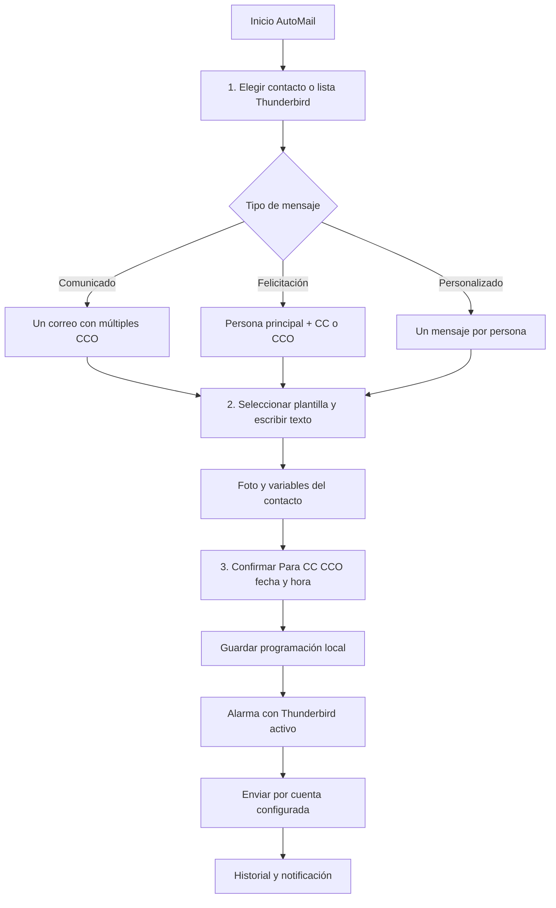

# ✉️ AutoMail — Correo Calendario para Thunderbird

**AutoMail 0.7.2 · Thunderbird 153 o superior · Complemento XPI independiente**

[](https://lordmanuel.github.io/automail/)
[](https://github.com/LORDMANUEL/automail)
[](https://github.com/LORDMANUEL/automail/releases)
[](https://github.com/LORDMANUEL/automail/actions)

> **Objetivo:** hacer sencillo programar correos, felicitaciones y comunicados usando las cuentas, contactos y listas que ya existen en Thunderbird. No requiere servidor adicional ni pedir de nuevo las credenciales SMTP.

## 📦 Descarga e instalación

**Página oficial:** https://lordmanuel.github.io/automail/

**Archivo XPI directo, V0.7.2:** https://lordmanuel.github.io/automail/downloads/correo-calendario-0.7.2.xpi\n\n**Versión anterior V0.7.1:** https://github.com/LORDMANUEL/automail/releases/tag/v0.7.1

**Releases de GitHub:** https://github.com/LORDMANUEL/automail/releases

**Manifiesto de actualización:** https://lordmanuel.github.io/automail/updates.json

1. Descarga el archivo `correo-calendario-0.7.2.xpi`.
2. En Thunderbird abre **Complementos y temas** → **⚙ Instalar complemento desde archivo**.
3. Selecciona el XPI y acepta los permisos necesarios para programar y enviar mensajes.
4. Abre AutoMail, selecciona remitente y prueba primero con tus propias direcciones.
5. Mantén Thunderbird ejecutándose (abierto o minimizado) y el equipo encendido para que se despachen los mensajes a la hora programada.

**SHA-256 del XPI V0.7.2:** `e329d382cbe19702a375ffcdad2413773933d12562d81b340369b5892a12976c`

> La V0.7.0 establece el canal definitivo `/automail/`. Quienes usaban V0.6.x deben instalar manualmente V0.7.x una vez, porque aquellas versiones apuntaban a otro canal. La **actualización automática futura requiere prueba real V0.7.1 → V0.7.2** y que la configuración de Thunderbird permita actualizaciones automáticas.

## 🌱 Origen y necesidad

AutoMail surgió de tareas reales de comunicación: felicitar a alguien con copia al equipo, evitar repetir cada saludo, aprovechar las listas de Thunderbird, administrar fotografías sin asignarlas a la persona equivocada y controlar exactamente a quién se manda cada mensaje. Se corrigieron problemas reportados de envíos individuales inesperados, listas CCO incompletas, plantillas con variables sin reemplazar, fotos y diseño en pantallas pequeñas.

Es un complemento **de uso general**: personal, educativo, empresas, Recursos Humanos y Servicio de Atención al Cliente son casos de uso, no módulos ni dependencias obligatorias.

## 🎯 Visión, objetivos y métricas

La visión es ofrecer un programador de correo ligero, seguro, fácil de aprender y auditable, que conserve en Thunderbird el control de las cuentas.

**Objetivos funcionales:** tres pasos para crear un envío, reutilizar contactos vCard y listas nativas, separar Para/CC/CCO, personalizar HTML/fotos, programar, mantener historial y distribuir versiones verificables por HTTPS.

**Criterios de calidad:** no generar duplicados ambiguos, bloquear listas incompletas antes del envío, validar variables de plantillas y proteger contactos/fotografías. La aceptación del envío por Thunderbird o SMTP no garantiza entrega final en cada buzón.

## 🔁 App Flow



## ✨ Funcionalidades

- Calendario interno, programación por fecha y hora, pendientes y avisos.
- Un comunicado con múltiples destinatarios en **CCO**.
- Felicitación dirigida a un contacto, con copia a compañeros en **CC o CCO**.
- Agenda nativa de Thunderbird: libretas, listas, búsquedas y cumpleaños `BDAY`.
- Edición de datos del contacto y fotografía asociada por ID de vCard, cuando la libreta permite escritura.
- Plantillas reutilizables HTML/CSS, fotos y campos dinámicos.
- Interfaz claro/oscuro, adaptable a laptops, con escala ajustable.
- Almacenamiento local y mecanismo de actualización mediante manifiesto HTTPS y SHA-256.

## 🏗️ Arquitectura

| Componente | Responsabilidad |
| --- | --- |
| `manifest.json` | Identidad, permisos, versión y `update_url` |
| `background.js` | Alarmas, trabajos y envío con API Compose |
| `contact-manager.js` y `contact-profile.js` | Contactos, listas y vCard |
| `dashboard.html`, `dashboard.js`, `style.css` | Interfaz de uso |
| `email-css.js`, `poster.js`, `photo-db.js` | Plantillas, tarjetas y biblioteca local |
| `web/` | Web pública Next.js con exportación estática |
| `tools/` | Compilación XPI reproducible, hash, QA y despliegue |
| `.github/workflows/` | CI, GitHub Pages y releases |

No hay recopilación de contraseñas SMTP ni un servidor de envío independiente. El equipo debe estar encendido y Thunderbird en ejecución; tampoco se ofrece sincronización bidireccional nativa con el calendario.

## 🧪 Prueba de estrés de 100 programaciones (V0.7.2)

La prueba automatizada genera 100 programaciones en cuatro lotes simultáneos, simula tres reinicios del motor con el mismo almacenamiento y verifica **100/100 registros conservados, 99 aceptaciones SMTP simuladas, uno en «Revisar» después de una interrupción y cero duplicados**. También comprueba un lote directo de 100 trabajos, la serialización de escrituras y el límite precautorio de cinco despachos por alarma. Ver [informe de estrés](docs/QA_STRESS_V072.md) y [notas de la versión](docs/RELEASE_V072.md).

**Límite de alcance:** el resultado se obtuvo con simulación de API; no demuestra entrega SMTP real ni funcionamiento mientras Thunderbird esté cerrado. Los envíos vencidos se recuperan al reabrir la aplicación.

## 🧪 Compilación y pruebas

Requisitos locales: Python 3.12+, Node.js 22+ y, para la web, npm.

```bash
python3 tools/package_release.py --base-url https://lordmanuel.github.io/automail/
python3 tools/qa_v070.py
cd web
npm install
npm run build
cd ..
python3 tools/ci_prepare_site.py --require-package
```

El archivo compilado aparece en `site/downloads/correo-calendario-0.7.0.xpi`. El manifiesto se genera en `site/updates.json`; el mismo XPI se publica en `docs/downloads/` por GitHub Actions, junto con `docs/updates.json`.

Las pruebas locales cubren sintaxis JS, listas CCO, vCard, fotografías, plantillas de gran tamaño y SHA-256. **La recepción SMTP real, la actualización automática entre versiones y la revisión oficial de Mozilla/ATN no están certificadas**.

## 🚀 Versionado y GitHub Pages

Se utiliza versionado semántico `MAJOR.MINOR.PATCH`: `0.7.0`, `0.7.1`, `0.7.2`, etc. No sustituir el binario de una versión ya publicada: crear una nueva versión y un nuevo XPI.

- **Pages**: Actions compila Next.js y publica HTML/CSS/JS en `docs/`.
- **XPI**: el script empaqueta el código runtime y genera SHA-256.
- **Actualizaciones**: `updates.json` identifica la versión, URL y hash del XPI.
- **Releases**: GitHub Actions crea una release versionada; no sobrescribe versiones existentes.
- **QA**: GitHub Actions ejecuta compilación del sitio y pruebas automáticas.

## 📚 Documentación

| Recurso | Archivo |
| --- | --- |
| Origen y visión | [ORIGEN_Y_VISION.md](docs/ORIGEN_Y_VISION.md) |
| Requisitos de producto | [PRD.md](docs/PRD.md) |
| Arquitectura técnica | [TRD.md](docs/TRD.md) |
| App Flow | [APP_FLOW.md](docs/APP_FLOW.md) |
| Metas y roadmap | [ROADMAP.md](docs/ROADMAP.md) |
| Historial de cambios | [CHANGELOG.md](docs/CHANGELOG.md) |
| QA | [QA.md](docs/QA.md) |
| Privacidad | [PRIVACY.md](docs/PRIVACY.md) |
| Revisión preliminar ATN | [MOZILLA_REVIEW.md](docs/MOZILLA_REVIEW.md) |
| Despliegue web | [NEXTJS_DEPLOY.md](docs/NEXTJS_DEPLOY.md) |

## ⚖️ Privacidad, licencia y revisión

El complemento puede acceder a contactos, direcciones, fotografías y contenido de mensajes necesario para sus funciones. La información permanece en el perfil Thunderbird, salvo el envío solicitado al servidor SMTP ya configurado. Consulta [PRIVACY.md](docs/PRIVACY.md).

El repositorio **no concede una licencia de código abierto por omisión**; antes de reutilizar o redistribuir material gráfico corporativo, confirma sus permisos. AutoMail es independiente de Mozilla y Thunderbird. La evaluación local no reemplaza la aprobación de ATN.

---

**Agradecimientos a Luis Manuel Fajardo.**
